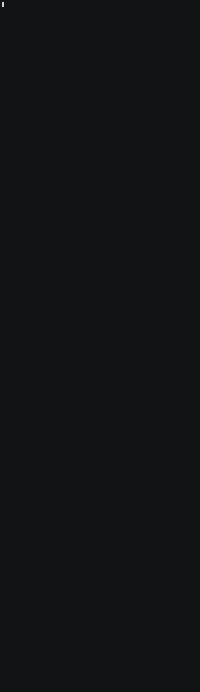

# AI Research Knowledge Graph

**29,707 nodes. 62,842 edges.** 1,000 open problems in AI and machine learning, with the papers, people, labs, assumptions, gaps and next experiments around them, from 1 source.

> Part of the **Samyama** ecosystem: loaded into and queried with [samyama-graph](https://github.com/samyama-ai/samyama-graph). Sibling of the **DBMS Research KG** (`samyama-graph/case_studies/dbms-research`), built the same way from the sibling catalog.

<a href="LICENSE"></a>
Content licence: **to be decided before publishing**: the source states no licence, CC BY 4.0 is proposed (see [`docs/standards.md`](docs/standards.md)).



---

Find where AI research is open and where it is stuck: which problems share papers, people and
assumptions, which experiments are cheap to run, and why problems stay hard, every answer traceable
to the catalog page it came from.

We loaded the [`ai_research`](https://github.com/samyama-ai/ai_research) catalog into one graph, then asked:

> *"Which papers are cited across the most AI research topics?"*

```cypher
MATCH (t:Topic)<-[:IN_TOPIC]-(p:Problem)-[:CITES]->(pa:Paper)
RETURN pa.title AS paper, count(DISTINCT t.id) AS topics
ORDER BY topics DESC LIMIT 5
```

| paper | topics |
|---|---|
| Training Compute-Optimal Large Language Models | 28 |
| Scaling Laws for Neural Language Models | 20 |
| Lost in the Middle: How Language Models Use Long Contexts | 15 |
| RULER: What's the Real Context Size of Your Long-Context Language Models? | 15 |
| Quantifying Memorization Across Neural Language Models | 13 |

And why problems stay open, which the catalog names in "Why It Is Hard":

| obstruction | problems |
|---|---|
| Confounded measurement | 521 |
| Non-identifiability | 458 |
| Absent ground truth | 208 |
| Compute cost | 137 |
| Evaluation does not measure what it names | 104 |

All numbers come from the v1.1 build of 2026-10-12 (`python -m etl.build`, catalog commit `a02e87b3`; `tests/test_invariants.py` pins them, and the engine load of the same day matched them). `benchmarks/queries.py` reproduces the two tables (AR15, AR08).

---

## Schema

**Node labels** (11): Problem 1,000 · Topic 35 · Paper 4,932 · Person 15,102 · Venue 527 · Institution 51 · Assumption 3,263 · OpenQuestion 3,790 · Obstruction 6 · FutureDirection 1,000 · DataSource 1

**Edge types** (11): `IN_TOPIC` 1,000 · `CITES` 12,615 {role, role_raw, position} · `AUTHORED_BY` 28,757 {position} · `APPEARED_AT` 4,365 · `RESTS_ON` 3,263 {position} · `HAS_GAP` 3,790 {position} (`kind` is on the OpenQuestion) · `BLOCKED_BY` 1,448 {detail, is_primary} · `HAS_NEXT_EXPERIMENT` 1,000 · `ACTIVE_ON` 2,476 {direction} · `RELATED_TO` 3,128 {method, shared_papers, score} (computed from shared papers) · `FROM_SOURCE` 1,000

**Data source**: `github.com/samyama-ai/ai_research` only, pinned at commit `a02e87b3`. There are no external lookups and no LLM extraction; every node is parsed from the catalog's Markdown.

See [`schema/ai_research_kg.cypher`](schema/ai_research_kg.cypher), [`docs/schema.md`](docs/schema.md) and [`DATASET_CARD.md`](DATASET_CARD.md).

## Standards, coding systems, taxonomies and ontologies

The shared language of the graph, in the sense of the Samyama KG guide's Layer 1. Four kinds of
thing, each with a plain meaning:

| Kind | In plain words | How many here |
|---|---|---|
| **Coding system** | a list of codes where each code names exactly one thing | 9 external + 14 own |
| **Taxonomy** | a list of categories, usually a tree, that things are sorted into | 2 in use, 2 more proposed |
| **Ontology** | the blueprint: which kinds of things exist and how they may connect | 1 own + 8 followed |
| **Standard / framework** | a rulebook we obey or reuse as a vocabulary | 5 followed + 1 proposed + 4 later |

**Coding systems.** External: arXiv identifier and DOI for papers (loaded), ISO 8601 for dates
(loaded), the git commit SHA-1 for the catalog version (loaded), and five planned for when external
lookups are allowed: DBLP person id, ORCID iD, DBLP stream key for venues, arXiv category, ROR and
OpenAlex ids. Own: three identifier conventions (topic number and slug, problem id, one id pattern per
node label) and eleven code lists in [`schema/concepts.yaml`](schema/concepts.yaml): `problem_status`,
`catalog_provenance`, `cites_role`, `gap_kind`, `obstruction`, `assumption_status`, `name_form`,
`institution_kind`, `extraction_method`, `relatedness_method`, `provenance`. Every coded value in the
graph is on its list (conformance check C9).

**Taxonomies.** The catalog's 35 research topics (`TAXONOMY.md`, one level; every problem sits in
exactly one, checks T1–T7) and the catalog's obstruction types (`TEMPLATE.md` §6, five types plus
`other`). Proposed, not built: six topic areas above the topics and the scope terms below them
([docs/taxonomy.md](docs/taxonomy.md)).

**Ontologies.** Our own, [`schema/ai_research_kg.ttl`](schema/ai_research_kg.ttl) (OWL/Turtle,
explained in [docs/ontology.md](docs/ontology.md)): the 11 node labels and 11 edge types above,
with domain, range, cardinality, id patterns and code lists, which the conformance tool checks the
graph against. Followed, meaning our terms are aligned with theirs so other tools understand the
graph: SKOS (topics and obstructions are concepts), PROV-O (provenance fields), CiTO (citation
roles), FaBiO (papers), schema.org (papers, people, venues, institutions), FOAF (people and
organisations), DCAT and Dublin Core (the data source), ORKG (research problems).

**Standards and frameworks.** Followed: the Samyama KG naming conventions, PROV-O provenance on
every node, computed facts labelled as computed (`RELATED_TO` carries `method` and `score`), a pinned
source commit so a rebuild gives the same graph, and ISO 8601. Proposed, waiting on the lead:
CC BY 4.0 as the graph's licence. Recorded for a later Responsible AI extension and not used yet:
NIST AI RMF, the EU AI Act, ISO/IEC 42001, the OECD AI Principles. Deliberately not used: ACM CCS,
Semantic Scholar, Papers with Code (shut down in 2025), leaderboards and citation counts.

Everything above in detail, with what the graph holds from each and the measured check ids:
**[docs/standards.md](docs/standards.md)**. Whether the graph keeps all of these rules is measured by
`python -m etl.conformance --url http://127.0.0.1:8090` (latest report:
[docs/conformance.md](docs/conformance.md), 31 pass, 0 fail, 14 measurements).

## Demo

Ten questions a researcher starts from, answered on the built graph and recorded as the GIF above:
how open the field is, the most open topics, the papers and surveys the problems share, the labs
named on open problems, why problems stay hard, the problems closest to one problem, the cheapest
and the single-machine experiments, and a question the graph must refuse. Every number is read from
the graph at run time, and each step says what its answer rests on: text parsed from the page, one of
our fixed rules, a computed link, or no data. See [demo/](demo/README.md).

```bash
python -m demo.demo --url http://127.0.0.1:8090          # paced walkthrough, one query at a time
python -m demo.demo --long --url http://127.0.0.1:8090   # the one-screen report the GIF shows
```

The ten queries, ready to paste into Samyama Insight: [demo/queries.cypher](demo/queries.cypher). All
35 scope questions run with `python -m benchmarks.run`, each checked against a plain-Python answer
([benchmarks/README.md](benchmarks/README.md)).

## Quick Start

```bash
python3 -m venv .venv && source .venv/bin/activate
pip install -e ".[dev]"

# an empty engine, pinned to the image the counts were measured on (1.11.0);
# the CORS flag lets Samyama Insight connect, see docs/ENGINE-NOTES.md
docker run -d --name samyama-ai_research -p 8090:8080 \
  ghcr.io/samyama-ai/samyama-graph@sha256:fc9a74053554f0be76fdc3973bbc2e5ff05cbb767aa27953ce184e9503206bd4 \
  samyama --host 0.0.0.0 --cors-origin https://graph.samyama.cloud

python -m etl.download_data                         # catalog -> data/ai_research (pinned commit; writes data/ai_research.lock.json)
python -m etl.loader --url http://127.0.0.1:8090    # parse + load + verify counts (~30 s)
python -m etl.build                                 # the same graph without an engine -> data/graph.json
python -m benchmarks.run                            # the scope.md questions, 35 queries, each checked
python -m etl.conformance --url http://127.0.0.1:8090   # taxonomy/ontology/coding/standards checks
pytest                                              # parser, invariant, count, query-catalog and standards tests

# snapshot: export the loaded graph + its manifest into snapshots/ (git-ignored)
python -m etl.snapshot export --url http://127.0.0.1:8090
```

### Or skip the build: load the snapshot

The built graph is shared **inside the team** as `ai-research.sgsnap` (3.5 MB), outside git like
the other KGs' snapshots; it is not published, because the source states no licence yet (S8 in
`docs/conformance.md`, issue #6). Ask the maintainers for it; where it will be hosted is being
decided in issue #6.
It comes with its `manifest.json`, which records its SHA-256 and counts; `snapshots/` is
git-ignored, so share the two files together. Put both in `snapshots/` and import
it into a **fresh** server (import appends, so `etl.snapshot import` refuses a non-empty one and
checks every count against the manifest afterwards):

```bash
docker run -d --name samyama-ai_research-snap -p 8092:8080 \
  ghcr.io/samyama-ai/samyama-graph@sha256:fc9a74053554f0be76fdc3973bbc2e5ff05cbb767aa27953ce184e9503206bd4 \
  samyama --host 0.0.0.0 --cors-origin https://graph.samyama.cloud
python -m etl.snapshot import --url http://127.0.0.1:8092
```

`python -m etl.build` builds the graph without an engine and writes `data/graph.json`.

## Structure
```
etl/download_data.py   # clone ai_research at the pinned commit; checks the checkout is clean and at that commit
etl/rules.py           # the fixed lists: citation-role buckets, venue aliases, obstruction types, institutions
etl/text.py            # Markdown helpers: sections (by heading text), frontmatter, lists
etl/parse.py           # one page -> references, assumptions, gaps, experiment, labs
etl/build.py           # catalog walk -> Graph (ids, paper dedup, computed RELATED_TO)
etl/loader.py          # schema + batched load + count verification
etl/helpers.py         # Cypher literals, identifier checks, batched CREATE
etl/conformance.py     # checks the graph against taxonomy, ontology, code lists, standards (etl/conformance_lib.py: inputs, report)
etl/snapshot.py        # export/import the .sgsnap, write and check its manifest.json
etl/count_kg.py        # Phase 1 size estimate (kept for reference)
schema/                # Cypher schema (indexes), the ontology in OWL/Turtle (ai_research_kg.ttl),
                       # the controlled vocabularies (concepts.yaml)
benchmarks/queries.py  # query catalog AR01-AR33, AR90-AR91, with scope.md coverage
benchmarks/reference.py # every query answered again in plain Python, and check()
benchmarks/run.py      # runs, times and checks the catalog
mcp_server/            # MCP server exposing the graph to agents (from the KG template; not yet adapted)
demo/                  # narrated walkthrough (demo.py), its ten queries, the recorder (record.sh), the cast and the GIF
demo/insight_proxy.py  # local CORS proxy so Samyama Insight can reach the engine (docs/ENGINE-NOTES.md)
docs/                  # scope, schema (as built) and the v0.1 plan, standards, ontology, taxonomy, coding standards, conformance, engine notes, logs
tests/                 # parser tests on fixtures, full-graph invariants, count, query-catalog and standards tests
```

## Docs

- [docs/standards.md](docs/standards.md): every standard, coding system, taxonomy and ontology, and whether the graph keeps it
- [docs/ontology.md](docs/ontology.md): the ontology in words; the file is [`schema/ai_research_kg.ttl`](schema/ai_research_kg.ttl)
- [docs/taxonomy.md](docs/taxonomy.md): how the graph follows the 35 topics, and seven refinements for the lead to decide
- [docs/conformance.md](docs/conformance.md): the measured report, 31 checks and 14 measurements
- [docs/schema.md](docs/schema.md): the graph as built; [docs/schema-v0.1-plan.md](docs/schema-v0.1-plan.md): the Phase 1 plan it grew from
- [docs/scope.md](docs/scope.md): the core question and the 41 questions the graph answers (or refuses)
- [docs/coding-standards.md](docs/coding-standards.md): how code, queries, data and documents are written here
- [docs/ENGINE-NOTES.md](docs/ENGINE-NOTES.md): measured engine behaviour
- [DATASET_CARD.md](DATASET_CARD.md): source, licence, how each part is built, known limits
- Work logs: [docs/phase1-log.md](docs/phase1-log.md), [docs/phase2-log.md](docs/phase2-log.md), [docs/2026-10-07-log.md](docs/2026-10-07-log.md)

## Known limits (v1.1)

- **No Method nodes.** The bold text in "State of the Art" is evidence labels ("Established", "Claimed but unablated"), not method names, so methods can't be extracted without an LLM or an outside source.
- **People are not resolved.** The catalog writes authors three ways (`Wortsman`, `T. Moerland`, `Rico Sennrich`). As in the DBMS KG, bare surnames are never merged into full names; filter on `name_form = 'full'` for people queries.
- **Institutions** are matched by name against a fixed list of 52 labs and universities in "Current Research" (51 occur in the catalog; MIRI never does).
- **No embeddings / vector search.** The DBMS KG used OpenAI embeddings; this build uses nothing outside the catalog.

## License

Apache-2.0 for the code: see [LICENSE](LICENSE). The graph's content comes from `ai_research`, which
states no licence yet; CC BY 4.0 is proposed and no snapshot is published until the owner decides
(see [docs/standards.md](docs/standards.md) and issue #6).
